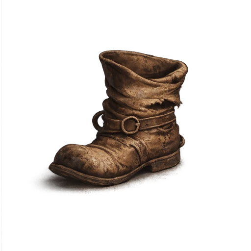
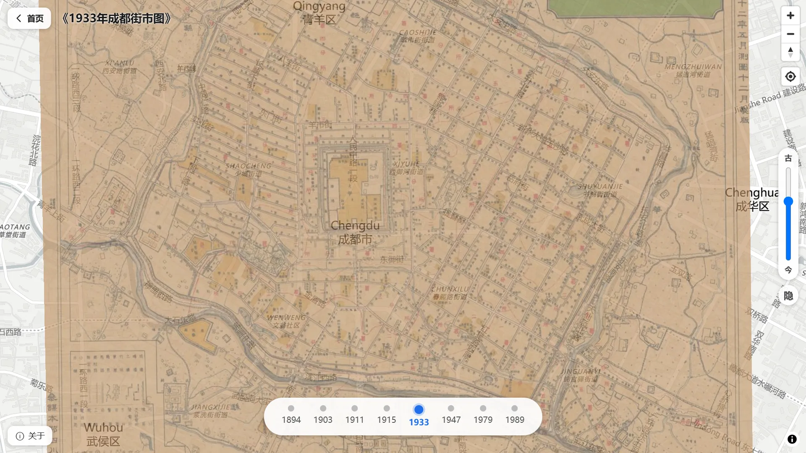
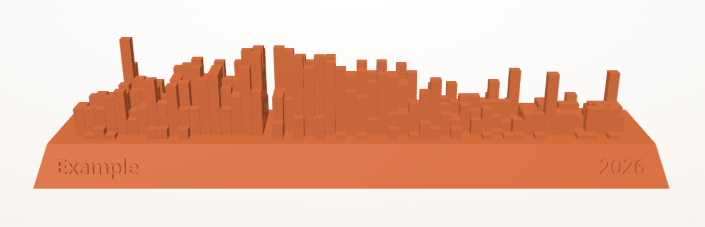

# Portkey Tools · 门钥匙集散中心

> 批发门钥匙，带你去有趣的地方。

**入口 → [tools.portkey.click](https://tools.portkey.click)**

一组打开网页就能用的小工具：不用安装、不用注册，数据尽量留在你自己的浏览器里。

| 工具 | 它能帮你做什么 | 入口 |
|---|---|---|
| 🗺️ **成都老地图** | 把不同年代的成都老地图叠在今天的地图上，拖动滑块看街巷、城墙和河道怎么变迁 | [打开 →](https://tools.portkey.click/cd-old-map) |
| 📊 **刻印** | 把一年的 GPT、Claude 用量等每日记录做成 skyline 3D 模型，在浏览器里生成、预览、下载 | [打开 →](https://tools.portkey.click/keyin) |

## 🗺️ 成都老地图

- **古今对照**：老地图经过地理配准，和现代地图的街道对得上；透明度滑块在「古」「今」之间淡入淡出。
- **时间轴**：从清末到上世纪八十年代，一键切换年代。
- **一个链接分享**：地址栏记着当前年代、位置和透明度，复制链接，别人打开看到的就是同一个画面。
- **大陆直接访问**：底图和老地图都自托管，不依赖被墙的服务。

原理与维护见 [`docs/cd-old-map.md`](./docs/cd-old-map.md)；想补充一张老地图，见 [`docs/adding-a-map.md`](./docs/adding-a-map.md)。

## 📊 刻印

- **一年一座「天际线」**：一天一根柱子，高度对应当天的数值，底座印上平台名、你的名字和年份。
- **数据来源多**：AI、编程、运动健康、影音阅读、笔记任务等平台，也可以用你自己的 JSON / CSV；每个平台都附有获取数据的步骤。
- **隐私友好**：文件在浏览器里读取和计算，不上传；只有 GitHub、LeetCode 的公开日历经本站转发。
- **什么文字都能印**：中日韩、阿拉伯文、emoji 都能正确排版。

衍生自 [GitHubPoster](https://github.com/yihong0618/GitHubPoster) 的 skyline 功能。平台列表、原理与维护见 [`docs/keyin.md`](./docs/keyin.md)。

## 反馈与参与

- **反馈问题、想要新工具或新平台**：到 [Issues](https://github.com/MamaShip/portkey-tools/issues/new/choose) 选对应的模板。
- **本地开发**：Node 22 + pnpm，`pnpm install && pnpm dev`。架构、目录与质量闸门见 [`docs/development.md`](./docs/development.md)。
- **贡献代码或地图**：见 [`CONTRIBUTING.md`](./CONTRIBUTING.md)。

## 许可

代码为 [AGPL-3.0-or-later](./LICENSE)；成都老地图的配准数据为 CC0，老地图本身为公共领域；刻印中衍生自 GitHubPoster 的文件保留 MIT，Noto 字体为 OFL 1.1。分层说明与版权问题联系方式见 [`docs/licensing.md`](./docs/licensing.md)。

## 致谢

[GitHubPoster](https://github.com/yihong0618/GitHubPoster) · [HarfBuzz](https://harfbuzz.github.io) · [Noto](https://notofonts.github.io) · [three.js](https://threejs.org) · [Allmaps](https://allmaps.org)（TU Delft Library 等）· [glenrobson/iiif-tiler](https://github.com/glenrobson/iiif-tiler) · [OpenStreetMap](https://www.openstreetmap.org) · [OpenFreeMap](https://openfreemap.org) · [MapLibre](https://maplibre.org) · [Astro](https://astro.build) · IIIF 社区
