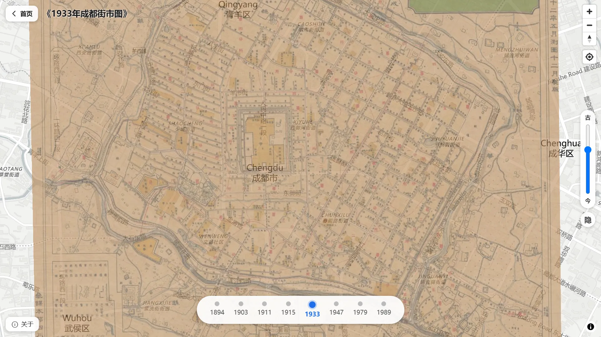

<!--
SPDX-License-Identifier: AGPL-3.0-or-later
Copyright (C) 2026 MamaShip
-->

# 成都老地图（cd-old-map）

路由 `/cd-old-map`。在现代地图上叠加经过地理配准的成都历史老地图：可以在时间轴上切换年代，用透明度滑块在古今之间淡入淡出，观察街道与城市形态的演变。

## 它是怎么工作的

- **现代底图**：[OpenFreeMap](https://openfreemap.org) positron（基于 OpenStreetMap 的矢量瓦片）的成都范围**快照，自托管在 Wasabi**（避开被 GFW 阻断的公共服务，大陆免翻墙可用），由 [MapLibre GL JS](https://maplibre.org) 渲染。全程 WGS-84 坐标系。机制与更新指南见 [`basemap.md`](./basemap.md)。
- **历史地图**：每张老地图切成静态 [IIIF](https://iiif.io) 瓦片托管在对象存储；用 [Allmaps](https://allmaps.org) 在浏览器内按控制点实时扭合（warp）叠加到现代底图上。配准产物是一份开放标准的 Georeference Annotation（JSON）。
- **站点**：[Astro](https://astro.build) + TypeScript（islands 架构），地图工具是一个仅客户端渲染的 React island。
- **托管**：应用在 Cloudflare Pages；历史图瓦片在对象存储（Wasabi），不入库。

架构、数据流与目录速查见 [`development.md`](./development.md)。

## 新增一张历史地图

**完整 SOP（含确切命令与踩坑速查）见 [`adding-a-map.md`](./adding-a-map.md)**，可独立照做。概要：

1. 预处理扫描图（裁切、纠斜）。
2. 切静态 IIIF 瓦片：`java -jar iiif-tiler.jar <map>.jpg -version 3 -output ./tiles`。
3. 上传瓦片到对象存储（`rclone copy ...`）——key 目录约定见 [`object-storage.md`](./object-storage.md)，资产放在 `tools/<toolId>/iiif/<mapId>/`。
4. 在 [Allmaps Editor](https://editor.allmaps.org) 对照现代底图打控制点 → 导出 Georeference Annotation 到 `src/tools/cd-old-map/data/annotations/<id>.json`。
5. 在 `src/tools/cd-old-map/data/maps.ts` 与 `src/tools/cd-old-map/data/epochs.ts` 登记该图。
6. `pnpm validate && pnpm test` 通过后提交 PR，在预览 URL 上肉眼确认对齐。

不会写代码也能帮忙：在 Allmaps 网页编辑器里校正控制点后导出标注，开 issue 提交即可，见 [`src/tools/cd-old-map/data/annotations/README.md`](../src/tools/cd-old-map/data/annotations/README.md)。

## 大文件政策

IIIF 瓦片（及可选的 PMTiles 底图）体量大、极少变动，**不进 Git**——它们存于对象存储，仓库内只保存其 URL 与几 KB 的标注 JSON。`tiles/` 为本地中转目录，已在 `.gitignore` 内。

## 许可

代码 AGPL-3.0-or-later；配准标注 CC0；历史地图图像为公共领域，不在本仓库内；现代底图需保留 OpenStreetMap / OpenFreeMap 署名。详见 [`licensing.md`](./licensing.md)。
